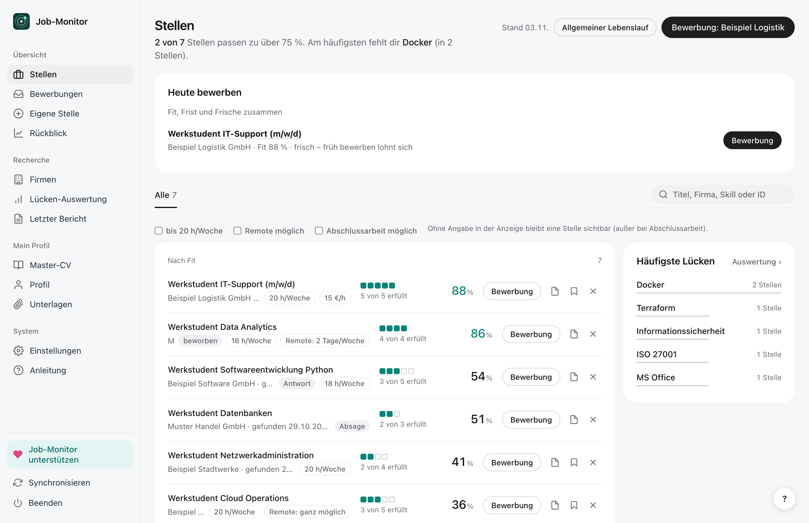
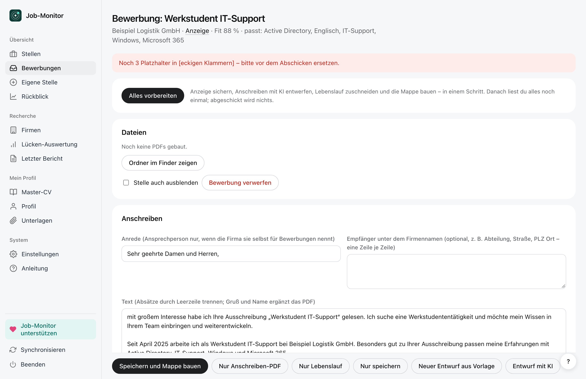
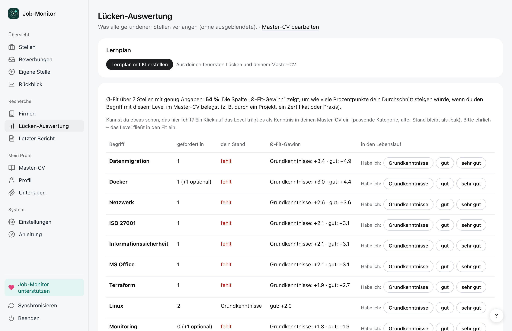
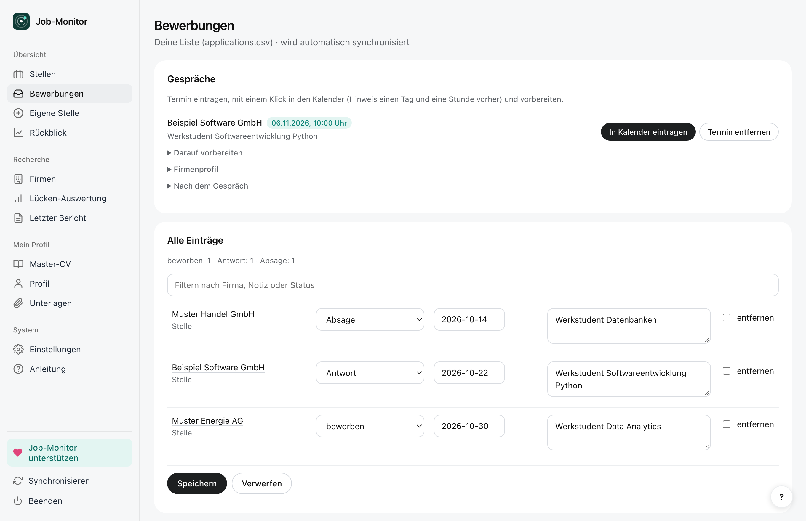
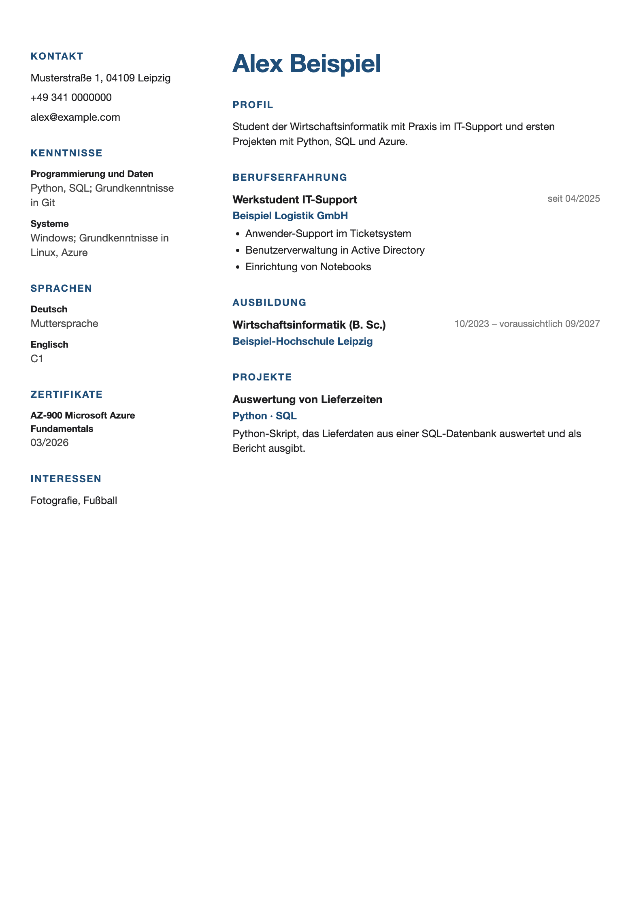

# Job-Monitor

Findet täglich passende Stellen für dich – für jede Fachrichtung und Karrierestufe, von Ausbildung und Werkstudent bis
Berufserfahrung –, bewertet, wie gut sie zu deinem Lebenslauf passen, und hilft bei Lebenslauf, Anschreiben,
Gesprächsvorbereitung und Nachfassen. Alles läuft auf deinem Rechner. **Bewerbungen und Mails an Firmen schickst du
immer selbst ab** – die App liefert nur Hinweise und Entwürfe.

**Website:** [emanuelajumobi-ux.github.io/jobmonitor](https://emanuelajumobi-ux.github.io/jobmonitor/) · **Fertige App für Mac und Windows:** [Downloads](https://github.com/emanuelajumobi-ux/jobmonitor/releases/latest) –
siehe [Installieren](#installieren). Was neu ist, steht in den [Neuigkeiten](NEUIGKEITEN.md). Ohne Einrichtung
ausprobieren: im Einrichtungs-Assistenten **Demo ansehen** (erfundene Beispieldaten).



<table><tr>
<td width="50%"><br>
<sub>Bewerbung vorbereiten – „Alles vorbereiten“ erledigt Anzeige, Anschreiben, Lebenslauf und Mappe in einem Schritt</sub></td>
<td width="50%"><br>
<sub>Lücken-Auswertung – was am häufigsten fehlt und wie stark der Fit steigen würde</sub></td>
</tr><tr>
<td width="50%"><br>
<sub>Bewerbungen mit Status, Gesprächen und Nachfassen</sub></td>
<td width="50%"><br>
<sub>Lebenslauf im Design „Modern“ (fünf Designs zur Wahl)</sub></td>
</tr></table>

<sub>Alle Bilder zeigen die Demo mit erfundenen Daten.</sub>

## Was Job-Monitor anders macht

Die meisten Bewerbungs-Apps kommen aus den USA, kosten ein Abo und speichern deine Daten auf ihren Servern.
Job-Monitor ist für die Jobsuche in Deutschland gebaut:

- **Kostenlos, ohne Konto, lokal:** alles bleibt auf deinem Rechner; KI nur, wenn du willst, mit deinem eigenen Zugang
  (mit Google Gemini auch kostenlos).
- **Erlaubte Quellen statt Scraping:** Jobsuche der Bundesagentur für Arbeit, Karriereseiten von Firmen (mit
  robots.txt), Hochschul-Jobbörsen und deine eigenen Job-Alert-Mails. LinkedIn, StepStone und Indeed werden nicht
  ausgelesen.
- **Jede Karrierestufe:** Minijob, Ausbildung, Praktikum, Werkstudent, Abschlussarbeit, Berufseinstieg und
  Berufserfahrene – mit eigenen Filtern und Suchprofilen für jedes Fach.
- **Deutsche Bewerbung:** tabellarischer Lebenslauf und Anschreiben in fünf Designs, auf Wunsch auf Englisch.
- **Pendelzeit statt Kilometer:** Stellen zählen, wenn sie mit Bus und Bahn in deiner Wunschzeit erreichbar oder
  remote sind.
- **Der ganze Weg:** Suche, Fit, Mappe, Gesprächsvorbereitung mit Übungsgespräch, Nachfassen und Rückblick.
- **Du schickst ab:** Die App versendet nie selbst Bewerbungen oder Mails.

## Was die App macht

- **Quellen:** Jobsuche der Bundesagentur für Arbeit, Arbeitnow (freie Job-Board-API), Karriereseiten von Firmen
  (Personio, Greenhouse, Lever, Recruitee, Teamtailor, JSON-LD, Sitemaps), Stellenwerk-Hochschulbörsen, Job-Alert-Mails
  aus deinem Postfach.
- **Bewerten:** Filter nach Rolle, Fach, Ort (Fahrzeit ab deinem Wohnort) und Remote; Fit gegen deinen Master-CV mit
  „passt“ und „fehlt“; optional liest eine KI die Anforderungen und Eckdaten (Stunden, Vergütung, Remote, Start).
- **Bewerben:** Lebenslauf und Anschreiben als PDF in fünf Designs (Klassisch, Modern, Kreativ, Kompakt, Akademisch –
  je Suchprofil oder Bewerbung wählbar), Prüfung vor dem Abschicken, Gesprächsvorbereitung,
  Nachfass-Entwürfe, Rückblick und Lücken-Auswertung mit Lernplan.

## Fehler gefunden, Idee?

In der App unter Einstellungen → **Feedback** (oder in der Anleitung ganz unten): „Fehler melden“ und „Idee
vorschlagen“ öffnen ein vorausgefülltes [Issue](https://github.com/emanuelajumobi-ux/jobmonitor/issues) – nur mit
Version und Betriebssystem, ohne persönliche Daten.

## Brauche ich GitHub?

Nein. Die App läuft komplett auf deinem Rechner: Die tägliche Suche plant sie selbst (Einstellungen → Zeitplan),
Downloads und Updates kommen von dieser Seite. GitHub brauchst du nur, wenn du am Code mitarbeiten oder die Suche als
GitHub Action in einem eigenen, privaten Repo laufen lassen willst.

## KI: dein eigener Schlüssel – empfohlen

Die App funktioniert ohne KI. **Das meiste holst du aber mit KI heraus:** Sie liest die Anforderungen und Eckdaten
jeder Anzeige (genauerer Fit), legt Suchprofile für dein Fach an, übernimmt deinen Lebenslauf aus einem PDF, schneidet
Lebensläufe auf die Stelle zu, schreibt Anschreiben-Entwürfe und bereitet Gespräche vor.

- **Die KI kommt von dir, nicht vom Entwickler.** Die App hat keinen eigenen Zugang und keinen Server. Empfohlen ist
  **Claude** (die App ist darauf abgestimmt; in der App führt eine Schritt-für-Schritt-Anleitung durch die Einrichtung).
  **Kostenlos ausprobieren** geht mit **Google Gemini** (kostenloses Kontingent ohne Kreditkarte, mit Tagesgrenzen;
  die Ergebnisse sind etwas schwächer als mit Claude – Anleitung in der App). Möglich sind auch **OpenAI, Mistral** und **Ollama** (läuft kostenlos auf deinem Rechner, nichts
  verlässt ihn). Den Schlüssel hinterlegst du unter Einstellungen → KI; er liegt im Schlüsselbund bzw. in der
  Windows-Anmeldeinformationsverwaltung.
- **Kosten trägst du über dein Konto beim Anbieter**, abgerechnet nach Verbrauch (bei Claude über vorher gekauftes
  Guthaben – kein Abo). Wie viel das ist, hängt davon ab, wie
  viele Stellen täglich neu dazukommen und wie oft du Entwürfe erstellen lässt. Für Aufrufe aus der Oberfläche gibt es
  ein Monatslimit (Standard 60, `ki.max_aufrufe_monat`); die tägliche Suche nutzt ein günstiges Modell und zeigt ihren
  Verbrauch in den Einstellungen.
- **Deine Daten gehen direkt an den Anbieter**, nie an den Entwickler dieser App. Gesendet werden Anzeigentexte und dein
  Master-CV ohne persönliche Angaben (Name, Adresse, Telefon, E-Mail und Foto bleiben lokal).

## Installieren

1. Unter **[Releases](https://github.com/emanuelajumobi-ux/jobmonitor/releases/latest)** `Job-Monitor-Mac.zip` oder
   `Job-Monitor-Windows.zip` laden und entpacken. Mac: `Job-Monitor.app` in den Programme-Ordner ziehen. Windows: Ordner
   an einen festen Ort legen und `Job-Monitor.exe` starten.
2. Beim ersten Start fragt das System nach, weil die App nicht signiert ist – **Mac:** Öffnen versuchen, dann
   Systemeinstellungen → Datenschutz & Sicherheit → „Trotzdem öffnen“. **Windows:** „Weitere Informationen“ →
   „Trotzdem ausführen“.
3. Der Einrichtungs-Assistent führt durch Angaben, Wohnort, Suchwunsch und Lebenslauf.
4. **Updates** zeigt die App selbst an: neue Version laden und die alte ersetzen – deine Daten im Ordner
   Dokumente/Job-Monitor bleiben erhalten.

## Neu einrichten oder vollständig entfernen

Deine Daten liegen nicht im App-Ordner, sondern in **Dokumente/Job-Monitor**. Wer nur die App löscht und neu
herunterlädt, findet darum seine Daten wieder.

- **Neu einrichten wie frisch installiert:** in der App unter Einstellungen → **Neu einrichten**. Auf Wunsch werden die
  alten Daten als Sicherung aufgehoben (Ordner „Job-Monitor (alt …)“) und die KI-Schlüssel entfernt; die tägliche Suche
  wird ausgeschaltet. Die App beendet sich, beim nächsten Start beginnt der Einrichtungs-Assistent.
- **Vollständig entfernen:** zuerst wie oben „Neu einrichten“ **ohne** Sicherung, die App startet danach nicht neu.
  Dann die App selbst löschen: Mac `Job-Monitor.app` aus dem Programme-Ordner, Windows den entpackten Ordner (den
  Startmenü-Eintrag entfernt das Zurücksetzen schon).
- **Von Hand**, falls die App nicht mehr startet: den Ordner Dokumente/Job-Monitor löschen; KI-Schlüssel im
  Schlüsselbund (Mac, Einträge „job-monitor-…“) bzw. in der Windows-Anmeldeinformationsverwaltung entfernen; die
  tägliche Suche unter Mac in `~/Library/LaunchAgents/de.jobmonitor.suche.plist`, unter Windows in der
  Aufgabenplanung („Job-Monitor Suche“) löschen; unter Windows außerdem die Verknüpfung „Job-Monitor“ im Startmenü
  (Rechtsklick → Dateispeicherort öffnen, dort löschen).

## Grundsätze

- **Kein Scraping von LinkedIn, StepStone, Indeed & Co.**, kein Login-Scraping, keine CAPTCHA-Umgehung. robots.txt wird
  nach RFC 9309 beachtet (inklusive Platzhaltern), mit ehrlichem User-Agent und Rate-Limit. Inoffizielle Schnittstellen
  nur nach ausdrücklicher Freigabe in `config.yaml` (`ats_freigabe`).
- **Persönliche Daten bleiben lokal:** Name, Adresse, Telefon, E-Mail und Foto stehen nur in `cv/profile.yaml` (nie in
  Git, nie an eine KI). Beim Lebenslauf-Import entfernt die App sie vor dem Senden an die KI und prüft das Ergebnis.
- **Zugangsdaten** (KI-Schlüssel, Mail-App-Passwort) liegen im Schlüsselbund bzw. in der Windows-Anmeldeinformations-
  verwaltung oder in Umgebungsvariablen, nie im Code.

## Aus dem Quellcode starten

```bash
python3.12 -m venv .venv && .venv/bin/pip install -r requirements.txt -r requirements-cv.txt -r requirements-app.txt
JOBMONITOR_HOME=~/Documents/Job-Monitor .venv/bin/python -m jobmonitor.app_start
```

Ohne `JOBMONITOR_HOME` nutzt die App diesen Ordner selbst als Datenordner; `config.yaml` und `companies.yaml` sind dann
ein Beispiel für Köln (Cloud/Security). Tests: `.venv/bin/python -m pytest -q` (Tests mit gespeicherten Fremdseiten
werden hier übersprungen – diese Seiten werden aus Urheberrechtsgründen nicht mitveröffentlicht).

Die tägliche Suche kann auch als GitHub Action in einem **privaten** Fork laufen (eigene Daten nie in ein öffentliches
Repo committen).

## Weiterempfehlen

Job-Monitor ist ein privates, kostenloses Open-Source-Projekt und bleibt es. Wenn dir die App bei der Jobsuche geholfen
hat, erzähl anderen davon – am besten mit dem Link zur Website:
[emanuelajumobi-ux.github.io/jobmonitor](https://emanuelajumobi-ux.github.io/jobmonitor/).

## Lizenz

[AGPL-3.0](LICENSE). Du darfst den Code nutzen, ändern und weitergeben; wer eine veränderte Fassung weitergibt oder als
Dienst anbietet, muss deren Quellcode ebenfalls unter der AGPL offenlegen.
